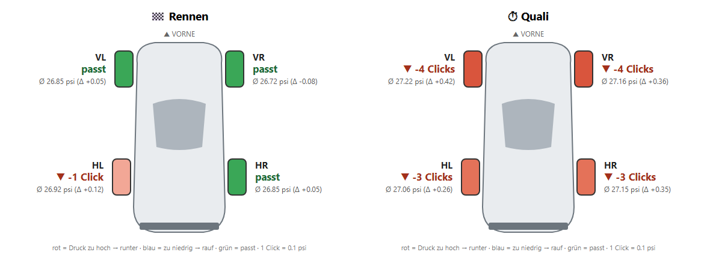
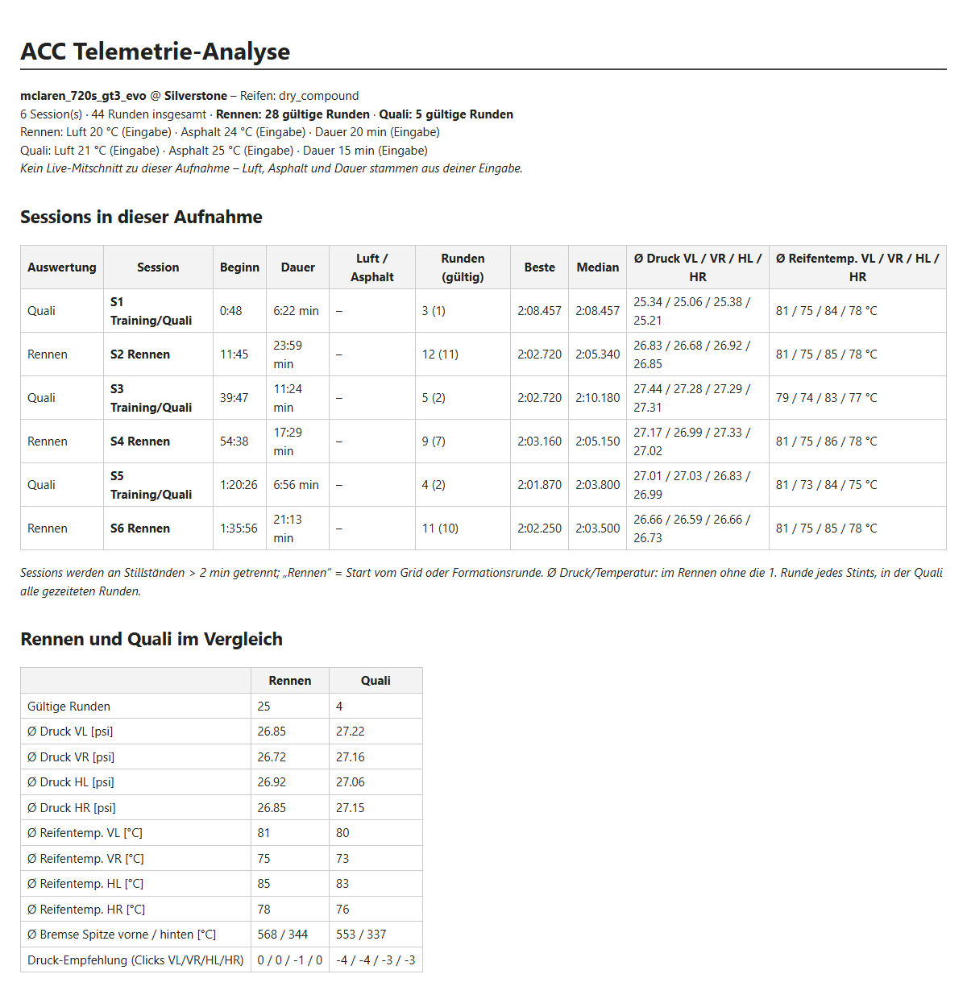
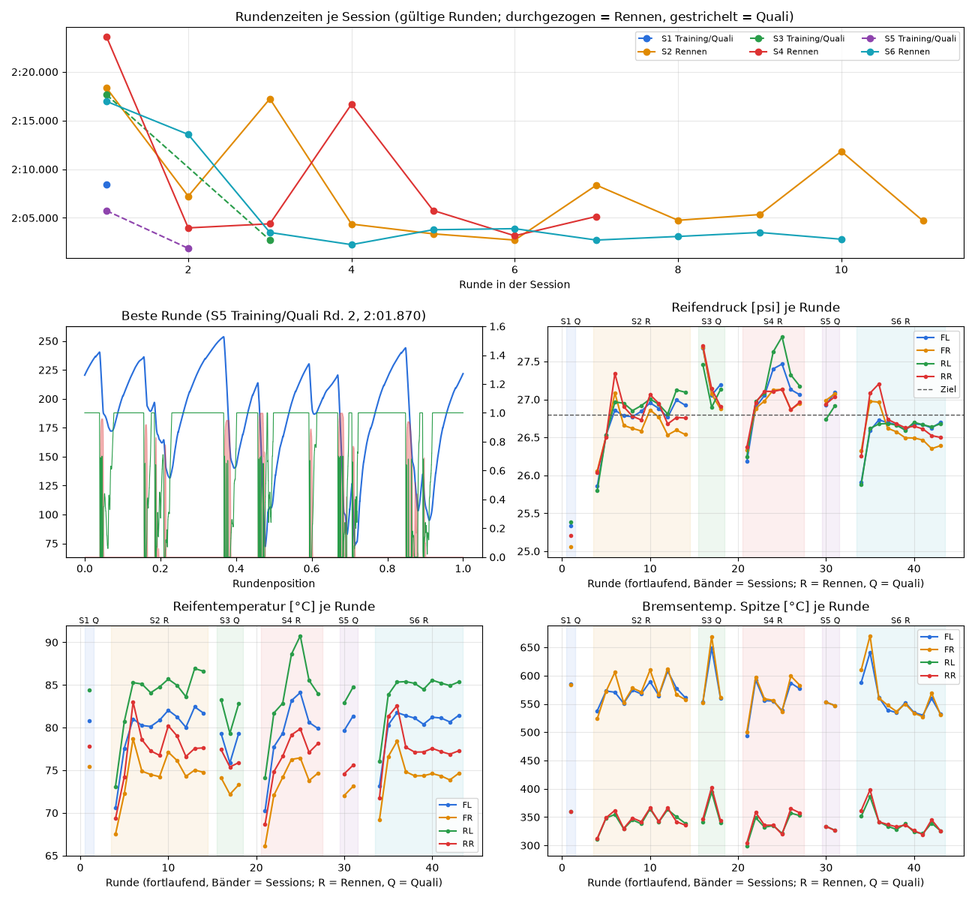

<p align="center">
  
</p>

<h1 align="center">ACC Setup-Analyzer</h1>

<p align="center">
  Wertet deine MoTeC-Telemetrie aus <b>Assetto Corsa Competizione</b> aus und schreibt dir ein angepasstes Setup –
  getrennt für <b>Rennen</b> und <b>Quali</b>. Ausgelegt für <b>GT3-Fahrzeuge</b>.
</p>

<p align="center">
  <a href="https://github.com/Crash343/acc-setup-analyzer/releases/latest"></a>
  <a href="https://github.com/Crash343/acc-setup-analyzer/actions/workflows/build-exe.yml"></a>
  
  <a href="LICENSE"></a>
</p>

<p align="center">
  
</p>

---

## Was das Tool kann

- **Erkennt Sessions und Runden automatisch.** Eine Aufnahme mit z. B. 3× Quali + 3× Rennen wird sauber getrennt.
  Jede Runde bekommt einen Typ (Start, Outlap, gezeitet, Box/Stopp, Inlap). Nur saubere Runden fließen in die Werte ein.
- **Rennen und Quali getrennt auswerten.** Jede Session ist als Rennen, Quali oder „nicht auswerten“ einstellbar.
- **Reifendruck pro Rad.** Die Draufsicht aufs Auto zeigt, welches Rad wie viele Clicks rauf oder runter braucht.
- **Weitere Empfehlungen.** Bremsbalance, Balance (Unter-/Übersteuern), Traktion, Fahrwerk/Bumpstops, Bremsbelüftung und Rundenzeit-Verluste.
- **Fertige Setup-Dateien.** Je Auswertung entsteht eine neue ACC-Setup-Datei, Name z. B. `20C_24C_39F.json` (Luft °C, Asphalt °C, Liter).
  Dein Original bleibt unverändert.
    - **Rennen**: Sprit für die Renndauer.
    - **Quali voll**: Sprit für die ganze Quali.
    - **Quali kurz**: Outlap, 3 schnelle Runden, Inlap.
- **Live-Mitschnitt während der Fahrt.** Luft- und Asphalttemperatur, Session-Art, Session-Dauer und Spritverbrauch kommen direkt aus ACC.
  Diese Werte stehen nicht im MoTeC-Export. **Geschätzt wird nichts.**
- **Ausführlicher HTML-Report** mit Tabellen und Diagrammen.

## Download & Start

1. **[ACC-Analyzer.exe herunterladen](https://github.com/Crash343/acc-setup-analyzer/releases/latest)**.
   Es ist eine einzelne Datei, eine Installation ist nicht nötig.
2. Doppelklick, und das Programmfenster öffnet sich.

> **Windows SmartScreen** meldet beim ersten Start evtl. „Der Computer wurde geschützt“. Klick dann auf *Weitere Informationen* → *Trotzdem ausführen*.
> Die .exe ist nicht signiert, und manche Virenscanner stufen solche Programme fälschlich als verdächtig ein.
> Der erste Start dauert ein paar Sekunden, weil die Datei sich selbst entpackt.

### Telemetrie in ACC einschalten (einmalig)
Stell im Setup unter **Electronics → Telemetry Laps** die Anzahl Runden ein, z. B. 99. ACC legt die Aufnahmen dann unter
`Dokumente\Assetto Corsa Competizione\MoTeC` ab (`.ld` + `.ldx`).

## So benutzt du es

1. **Aufnahme wählen:** Die neueste `.ld` aus dem MoTeC-Ordner ist schon vorausgewählt. Klick auf **Laden**.
2. **Gefahrenes Setup wählen** (optional, aber empfohlen): die `.json` aus `Dokumente\Assetto Corsa Competizione\Setups\<Auto>\<Strecke>`.
3. **Sessions prüfen:** Jede erkannte Session hat ein Auswahlfeld *Rennen / Quali / –*. Bei Bedarf ändern, dann **Neu auswerten**.
4. **Bedingungen prüfen:** Luft, Asphalt und Dauer je Rennen und Quali sowie die Anzahl schneller Quali-Runden.
   Mit Live-Mitschnitt sind die Felder ausgefüllt, sonst leer. Du kannst sie selbst eintragen, dann **Übernehmen**.
5. **Reiter 🏁 Rennen / ⏱ Quali:** Hier stehen die Auto-Grafik, die Empfehlungen und die Setup-Änderungen. Jede Änderung lässt sich abwählen.
   Danach je Variante **… speichern**. Vorgeschlagen wird der Ordner deines Setups, so taucht die Datei in ACC direkt in der Setup-Liste auf.
6. **Weitere Reiter:** **Übersicht** vergleicht Rennen und Quali. **Runden** listet jede Runde mit Typ, Zeit, Druck und Temperatur.
   *Ausführlichen Report im Browser öffnen* zeigt den HTML-Report, er liegt in `Dokumente\ACC-Analyse`.

**Drag & Drop:** Du kannst eine `.ld` (und optional die Setup-`.json`) auf `ACC-Analyzer.exe` ziehen. Das Fenster öffnet sich dann mit diesen Dateien.

## Live-Mitschnitt: Fenster beim Fahren offen lassen

Der MoTeC-Export enthält **keine** Luft- und Asphalttemperatur, keine Session-Art und -Länge und keinen Sprit.
Deshalb liest das Fenster diese Werte alle 5 Sekunden aus dem Speicher von ACC (Shared Memory), solange es offen ist.
Unten rechts steht dann z. B. *● Live: Quali, noch 12 min · Luft 19 °C · Asphalt 26 °C*.

- Gespeichert wird nach `Dokumente\ACC-Analyse\live\live_<Datum>.jsonl`.
- Beim Auswerten ordnet das Tool die Werte über die Uhrzeit den Sessions der Aufnahme zu.
  Damit gelten die Session-Art aus ACC, die echte Session-Dauer und der **gemessene** Verbrauch pro Runde.
- Das Fenster darf schon vor ACC offen sein. Es liest nur und verändert nichts an ACC.
- **Ohne Mitschnitt wird nichts geschätzt.** Die Felder bleiben dann leer, bis du die Werte selbst einträgst.
  Bis dahin bleibt der Sprit für *Rennen* und *Quali voll* unverändert. Die Datei heißt dann `<Original>_rennen.json` usw. statt `20C_24C_39F.json`.

## Die Setup-Dateien

| Variante | Sprit | Beispiel |
|---|---|---|
| 🏁 **Rennen** | Renndauer ÷ Ø-Rundenzeit (aufgerundet) + Formationsrunde + 1 Runde Reserve | `20C_24C_39F.json` |
| ⏱ **Quali voll** | Quali-Dauer ÷ Ø-Rundenzeit (aufgerundet) + Inlap + 1 Runde Reserve | `21C_25C_33F.json` |
| ⚡ **Quali kurz** | Outlap + 3 schnelle Runden + Inlap + 1 Runde Reserve | `21C_25C_20F.json` |

- **Druck und Fahrwerk** sind in beiden Quali-Varianten gleich, nur der Sprit unterscheidet sich.
- **Verbrauch pro Runde:** gemessen im Live-Mitschnitt, sonst `fuelPerLap` aus deinem Setup. Diesen Wert schreibt ACC selbst ins Setup, er ist eher vorsichtig.
- **Was geändert wird** (weitere Befunde werden nur aufgelistet, damit du nicht alles auf einmal änderst):
    - Reifendruck, Sturz und Bremsbelüftung, jeweils datengetrieben.
    - Die Click-Änderungen der **zwei wichtigsten Befunde**, z. B. Bremsbalance, Stabi, Federn, Diff-Preload, Heckflügel oder ABS.
- **Format:** Die Datei hat exakt das ACC-Format des Originals (Tabs, Zeilenenden, Zahlenformat). Ein Vergleich zeigt nur die geänderten Zeilen.
- **Setup für andere Temperaturen:** Lädst du z. B. `30C_38C_…` und fährst bei 20 °C, weist der Report darauf hin. Die Druck-Empfehlung beruht auf den
  gemessenen Drücken und gleicht das aus. Die neue Datei bekommt die echten Temperaturen im Namen.

## Der Report

<p align="center">
  
</p>

<details>
<summary><b>Diagramme im Report</b> (Rundenzeiten je Session, beste Runde, Druck, Reifen- und Bremsentemperatur je Runde)</summary>
<p align="center"></p>
</details>

## Wie ausgewertet wird

<details>
<summary><b>Sessions und Runden</b></summary>

- Eine `.ld` enthält oft mehrere Sessions. Getrennt wird an **Stillständen über 2 Minuten**. Kürzere Stillstände, etwa ein Boxenstopp
  oder Return-to-Pit in der Quali, bleiben in der Session.
- Mit Live-Mitschnitt kommt die Session-Art direkt aus ACC. Ohne gilt eine Session als **Rennen**, wenn sie mit einem Start vom Grid
  oder einer langsamen Formationsrunde beginnt.
- Rundengrenzen kommen aus den Beacons der `.ldx`, ergänzt um den `TIME`-Kanal.
- Als **gültig** zählt eine gezeitete Runde, wenn ihre Länge der normalen Rundenlänge entspricht und die Zeit höchstens 20 % über der besten liegt.
</details>

<details>
<summary><b>Rennen und Quali</b></summary>

- **Rennen:** Standard sind Rennen und Longruns (≥ 6 gültige Runden). Die 1. Runde jedes Stints zählt nicht zum Ø-Druck, weil die Reifen da noch kalt sind.
- **Quali:** alle übrigen Sessions mit gültiger Runde. Hier zählen alle gezeiteten Runden, weil die Outlap die Reifen schon anwärmt.
- **Ausreißer:** Ab 3 Sessions in einer Auswertung zählt eine Session nicht zum Ø, wenn ihr Ø-Druck mehr als 1 psi vom Median abweicht.
  Typische Ursache: andere Kaltdrücke. Der Report nennt die Session.
- **Toleranz:** Druckabweichungen bis ±0,1 psi gelten als „passt“. 1 Click = 0,1 psi.
</details>

## Grenzen

- **Nur GT3:** Zielwerte (Heißdruck 26,8 psi, Reifen- und Bremsentemperaturfenster) und Click-Richtungen sind auf ACC-GT3 abgestimmt.
  Mit GT4, GT2, Cup- oder Challenge-Autos sind die Empfehlungen nicht verlässlich.
- **Schwellwerte sind Annahmen.** Druckfenster, Temperaturen und Balance-Schwellen sind an echten Sessions plausibilisiert,
  aber nicht gegen ein „perfektes“ Setup kalibriert. Teste pro Fahrt nur 1–2 Änderungen.
- **Reifentemperatur:** Der MoTeC-Export hat nur einen Wert pro Rad, keine Innen/Mitte/Außen-Werte. Deshalb gibt es keine Sturz-Empfehlung aus Temperaturen.
- **Balance:** Unter- und Übersteuern werden aus Lenkreaktion, Gegenlenken und Raddrehzahlen abgeleitet. Schlupfwinkel exportiert ACC nicht.
- **Click-Richtungen:** Prüf sie im Garage-Screen kurz nach.
- **Datenmenge:** Bei nur 1 gültigen Runde sind die Reifenwerte unsicher. Am besten 3 oder mehr saubere Runden fahren.
- **Getestet** mit echten Aufnahmen: AMR V8 Vantage und McLaren 720S Evo in Barcelona, am Nürburgring und in Silverstone.

## Für Entwickler

```
pip install -r requirements.txt
python -m accanalyzer             # Fenster starten
python -m pytest tests            # Tests (mit Beispielaufnahme, falls lokal vorhanden)
build_windows.bat                 # .exe lokal bauen -> dist\ACC-Analyzer.exe
python tools/make_icon.py         # Programm-Icon neu zeichnen
```

- **Build:** Jeder Push auf `main` baut die .exe per GitHub Actions. Ein Tag `v*`, z. B. `git tag v1.0.0 && git push --tags`,
  legt zusätzlich ein **Release** mit der .exe an.
- **Struktur** (`accanalyzer/`):
    - `ldimport.py`: MoTeC lesen, Sessions und Runden erkennen.
    - `analysis.py`: Befunde und Empfehlungen.
    - `setupio.py`: Setup lesen, ändern, im ACC-Format schreiben.
    - `livelog.py`: Live-Mitschnitt.
    - `report.py`: Markdown/HTML und Diagramme.
    - `gui.py`: das Fenster.

## Lizenz & Quellen

- **Lizenz:** [GPL-3.0](LICENSE).
- `accanalyzer/vendor/ldparser.py` stammt von [gotzl/ldparser](https://github.com/gotzl/ldparser) (GPL-3.0). Deshalb steht auch das Gesamtprojekt unter GPL-3.0.
- `accanalyzer/knowledge.py` basiert auf [Setup Ripple](https://github.com/jojojing-dev/setup-ripple) von JojoJing (MIT, Lizenztext in `accanalyzer/vendor/`).
  Übernommen sind Fix-Pakete, Setup-JSON-Pfade, Click-Deltas, Druckfenster und Symptom-Ursachen, ins Deutsche übertragen und teils kombiniert.
- Assetto Corsa Competizione ist eine Marke von Kunos Simulazioni / 505 Games. Dieses Projekt steht in keiner Verbindung dazu.
